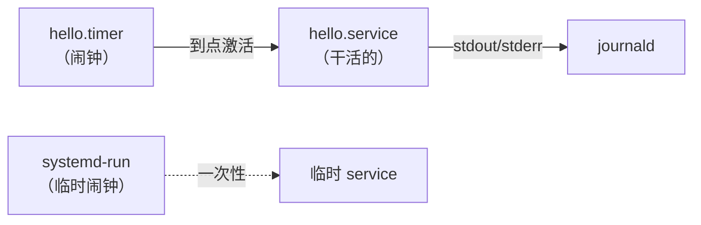

# systemd 日常使用教程：从「不敢碰」到「随手改」

> [!info] 这篇是什么
> 一份面向**日常桌面使用**的 systemd 教程。从零开始，只讲你真正会用到的东西，每个结论都在 Fedora Silverblue 45 上实测过。
>
> 姊妹篇：[[systemd-fedora-notes]]（2026-04 那篇是服务器 / root 视角的深水区参考手册，923 行，讲 cgroup 限制、SELinux、socket 激活那一套）。**这篇是入门 + 桌面日常**，两篇分工明确：先看这篇建立直觉，需要深挖时跳过去。

> [!tip] 怎么用这篇
> 不用一口气读完。跟着「七天练习」一天一节，每节 15 分钟，一周后你就能自己写 service / timer 了。遇到具体问题直接翻「速查卡」和「十个最常见的坑」。

---

## 0. 先建立一个心智模型

systemd 到底是什么？一句话：

> **它是开机后内核启动的第一个程序（PID 1），把系统上所有"要一直跑的东西"都登记成受管对象，负责按依赖顺序把它们拉起来、盯着它们、并在它们死掉时按策略重启，顺便把它们的输出统一收进日志。**

这句话里有四个关键点，理解了这四个，剩下的全是查表：

| 关键词 | 含义 | 对应命令 |
|---|---|---|
| **unit（单元）** | 被管理的最小对象。服务、定时器、挂载点、套接字都是 unit，靠后缀区分（`.service` / `.timer` / `.mount` / `.socket` / `.target`） | `systemctl list-units` |
| **依赖图** | unit 之间声明"要不要对方"（`Wants`/`Requires`）和"谁先谁后"（`After`/`Before`），systemd 据此拓扑排序，能并行的并行 | `systemctl list-dependencies` |
| **cgroup** | 每个服务被放进一个独立的进程组，所以"杀掉这个服务"等于"杀掉这一整组"，不会漏 | `systemd-cgls`、`systemctl kill` |
| **journal** | 所有服务的 stdout/stderr 统一进 journald，可按服务/开机次数/时间/优先级检索 | `journalctl -u 名字` |

### 为什么很多人觉得 systemd 难

不是因为它复杂，而是因为**它不会猜你的意图，也不会报错给你看**。你写错一个字段，它只丢一句 `Job failed`，真正的理由埋在 journal 里。所以入门的门槛其实不在"背配置项"，而在"学会看日志"——第 3 节会专门解决这件事。

还有一层误解：**日常根本不需要从零写配置文件**。90% 的活是"读一下现有配置"和"用 drop-in 改两行"（第 4 节）。真正从零写 unit，一年也用不了几次。

---

## 1. 五个动词搞定 90% 的操作

### 1.1 基本动作

```bash
systemctl status  foo.service     # 看状态（最常用，第一现场）
systemctl start   foo.service     # 立刻启动（本次开机有效）
systemctl stop    foo.service     # 停止
systemctl restart foo.service     # 重启
systemctl reload  foo.service     # 让程序重读配置（不重启进程，需要程序支持）
systemctl enable  foo.service     # 设为开机自启（下次开机生效，现在不启动）
systemctl disable foo.service     # 取消开机自启（现在不停）
systemctl enable --now foo.service  # 两步合一：设为自启 + 立刻启动
```

> [!warning] 新手最容易搞混的一对
> **`enable` 不等于 `start`，`start` 也不等于 `enable`。**
> `enable` 只是在 `/etc/systemd/system/multi-user.target.wants/`（或 user 单元在 `~/.config/systemd/user/*.wants/`）里建一个符号链接，决定"下次开机要不要起"；`start` 是现在就起。
> 所以"我 enable 了怎么没跑？"——因为它本来就没在跑，你得 `start`（或者用 `enable --now`）。

### 1.2 查看全景

```bash
systemctl list-units --type=service --state=running   # 正在跑的服务
systemctl list-unit-files --state=enabled             # 开机自启的都有谁
systemctl --failed                                    # 出错的单元（排查第一站！）
systemctl list-units --type=target                    # 看当前到达哪个 target
systemctl get-default                                 # 默认启动目标
```

### 1.3 `disable` 和 `mask` 的区别

| 操作 | 效果 | 适用场景 |
|---|---|---|
| `disable` | 取消开机自启，但仍可手动启动、也可被别的 unit 依赖拉起 | 一般不用了 |
| `mask` | 链到 `/dev/null`，**任何方式都启动不了**，连依赖也起不来 | 彻底封杀（比如屏蔽某个冲突服务） |
| `unmask` | 解除封杀 | 反悔 |

### 1.4 系统级 和 用户级

你的所有日常操作都应该先想着加 `--user`：

```bash
systemctl --user status   hermes-gateway.service
systemctl --user restart  hermes-gateway.service
journalctl  --user -u hermes-gateway.service -f
```

区别看第 7 节。先记住一句话：**不需要 root 的事，都放 `--user`**，它不碰系统、不需要 sudo、升级更安全。

---

## 2. 读懂 `status` 输出

这是 systemd 学习里性价比最高的一件事。拿本机真实的 `hermes-gateway` 举例（略有删节）：

```text
● hermes-gateway.service - Hermes Agent Gateway - Messaging Platform Integration
     Loaded: loaded (/var/home/smile/.config/systemd/user/hermes-gateway.service; enabled; preset: disabled)
     Drop-In: /usr/lib/systemd/user/service.d
              └─10-timeout-abort.conf
     Active: active (running) since Thu 2026-10-22 01:09:40 CST; 30min ago
   Main PID: 1351 (hermes)
      Tasks: 27 (limit: 18865)
     Memory: 412.3M (peak: 505.9M)
        CPU: 21.339s
     CGroup: /user.slice/user-1000.slice/user@1000.service/app.slice/hermes-gateway.service
             ├─1351 /var/home/smile/.hermes/.../hermes gateway run
             └─...
```

逐行对应你的疑问：

| 行 | 读法 |
|---|---|
| `●` / `×` | 实心圆 = 正常；`×` = failed |
| `Loaded:` | 配置从哪个文件加载；`enabled` 表示已开机自启；`preset:` 是**发行版出厂默认**（Fedora 用 preset 文件决定新装软件默不默认开启）。两者不一致是正常的 |
| `Drop-In:` | 这个单元身上叠了哪些补丁（第 4 节）。**看到它说明有人改过** |
| `Active:` | 宏观状态。`active (running)` 常驻；`active (exited)` 一次性任务跑完了；`failed` 挂了；`inactive (dead)` 没跑 |
| `Main PID` | 主进程号。注意它只指"主"进程，兄弟进程在下面的 cgroup 树里 |
| `Tasks` / `Memory` / `CPU` | 实时资源。`Memory` 是当前，`peak` 是峰值 |
| `CGroup:` | **最重要的一行**：这个服务包含的所有进程。想杀干净就 `systemctl kill 名字`，别 `killall` |

> [!tip] `failed` 不一定是真故障
> 本机就有一个活例子：
>
> ```text
> ● systemd-remount-fs.service loaded failed failed Remount Root and Kernel File Systems
> mount: /: fsconfig() failed: overlay: No changes allowed in reconfigure.
> ```
>
> Silverblue 的根是只读 overlay，remount 必然失败，这是**预期噪声**，不影响使用。判断标准：`systemctl --failed` 有东西 → 去看它的 journal → 如果报错内容和你的使用无关（比如这种 ostree 特性），忽略它。

---

## 3. 日志：`journalctl` 是半个 systemd

systemd 把日志统一收进 journald，替代了散落的 `/var/log/messages`。学会它，排查效率翻几倍。

### 3.1 五个开关覆盖日常

```bash
journalctl -u hermes-gateway.service              # 只看某个单元
journalctl -u hermes-gateway.service -b           # 只看本次开机
journalctl -u hermes-gateway.service -f           # 实时跟随（相当于 tail -f）
journalctl -u hermes-gateway.service -n 200       # 最近 200 行
journalctl -p warning..emerg -b                   # 只看 warning 及以上
journalctl --since "30 min ago" --until "now"     # 时间窗口（支持自然语言）
journalctl -b -1                                  # 上一次开机的全部日志（查"上次怎么崩的"神器）
journalctl -k                                     # 内核日志（= dmesg）
journalctl --user -u foo.service                  # 用户单元的日志（一定要加 --user）
```

### 3.2 持久化

```bash
ls -d /var/log/journal        # 有这个目录就说明持久化已开
journalctl --disk-usage       # 现在占多大
```

本机实测：`Archived and active journals take up 949.7M`——不小了，可以清：

```bash
sudo journalctl --vacuum-size=500M     # 只保留最近 500M
sudo journalctl --vacuum-time=14d      # 只保留 14 天
```

> [!note] 没持久化的话
> 默认可能只存内存（`/run/log/journal`），重启就没了。建目录即可开启：`sudo mkdir -p /var/log/journal && sudo systemctl restart systemd-journald`。

### 3.3 按字段检索（进阶但好用）

journal 是结构化的，每条记录带元数据。`journalctl -o verbose` 能看到 `_PID`、`_UID`、`_COMM`、`_SYSTEMD_UNIT` 等字段：

```bash
journalctl _COMM=hermes                  # 按进程名
journalctl _PID=1351                     # 按 pid
journalctl -u foo.service -o json-pretty # 原始结构化数据
```

### 3.4 排错套路（背下来）

> [!important] 服务起不来的三连
> ```bash
> systemctl status foo.service              # 1. 看第一现场（退出码、失败原因）
> journalctl -u foo.service -b -n 100       # 2. 看它自己说了什么
> systemctl cat foo.service                 # 3. 确认生效的配置长什么样（含 drop-in）
> ```
> 90% 的问题这三条就定位了。剩下 10% 才需要 `systemd-analyze verify` 和 SELinux 排查。

---

## 4. 改配置而不用写文件：drop-in

这是我觉得 systemd 设计里最省事的一环，也是"配置难"这个印象的主要来源——**其实你不用碰原文件**。

### 4.1 单元文件放在哪（优先级从低到高）

**系统级**（root，管整个系统）：

| 路径 | 说明 |
|---|---|
| `/usr/lib/systemd/system/` | 软件包安装的原始文件，**永远不要改**（Silverblue 上还是只读的） |
| `/run/systemd/system/` | 运行时临时覆盖，重启丢失 |
| `/etc/systemd/system/` | 管理员自定义，**优先级最高** |

**用户级**（你自己的 `--user` 实例）：

| 路径 | 说明 |
|---|---|
| `/usr/lib/systemd/user/` | 软件包提供 |
| `/run/user/1000/systemd/user/` | 运行时临时 |
| `~/.config/systemd/user/` | **你的地盘，优先级最高** |

本机实测的搜索路径顺序（`systemctl --user show -p UnitPath --value`）：

```text
/var/home/smile/.config/systemd/user.control
/run/user/1000/systemd/user.control
/run/user/1000/systemd/transient
/run/user/1000/systemd/generator.early
/var/home/smile/.config/systemd/user      ← 你写文件放这里
/etc/systemd/user
/run/user/1000/systemd/user
/usr/lib/systemd/user
```

### 4.2 正确姿势：`systemctl edit`

```bash
systemctl --user edit hermes-gateway.service
```

它会打开一个空文件，你只写**要改的那几行**，保存后生成：

```text
~/.config/systemd/user/hermes-gateway.service.d/override.conf
```

系统级对应 `/etc/systemd/system/NAME.service.d/override.conf`。这就是 **drop-in（补丁）**：只在原配置上叠加，原文件一个字不动，发行版更新也不会覆盖你的改动。

三种编辑模式：

| 命令 | 生成什么 | 用途 |
|---|---|---|
| `systemctl edit NAME` | `NAME.d/override.conf`（空文件，只写差异） | **首选**，改两行就用它 |
| `systemctl edit --full NAME` | `/etc/systemd/system/NAME.service` 完整副本 | 要大改、或者想整体重写 |
| `systemctl edit --runtime NAME` | `/run/...` 临时覆盖 | 临时调试，重启即失效 |

```bash
systemctl revert NAME.service    # 撤销所有 drop-in 和完整覆盖，回到出厂状态
```

> [!warning] 一个真实的坑
> `systemctl edit` **必须有终端（tty）**。我在脚本里调用它，直接报：
> `Cannot edit units interactively if not on a tty.`
> 所以自动化场景（脚本、Hermes）里就直接手写 `~/.config/systemd/user/NAME.service.d/override.conf`，效果完全一样。本机实测：
>
> ```console
> $ mkdir -p ~/.config/systemd/user/probe2.service.d
> $ printf '[Service]\nEnvironment=PROBE_FLAG=on\n' > ~/.config/systemd/user/probe2.service.d/override.conf
> $ systemctl --user daemon-reload
> $ systemctl --user show probe2.service -p Environment --value
> PROBE_FLAG=on
> ```

### 4.3 看合并后的最终结果：`systemctl cat`

```bash
systemctl cat NAME.service        # 原文件 + 所有 drop-in 按加载顺序连起来
systemctl --user cat NAME.service
```

本机实测的输出尾巴（注意 drop-in 是**叠加上去的**，最后一节是生效值）：

```text
# /var/home/smile/.config/systemd/user/probe2.service
[Unit]
Description=probe2

[Service]
Type=oneshot
ExecStart=/usr/bin/true

# /usr/lib/systemd/user/service.d/10-timeout-abort.conf
[Service]
TimeoutStopFailureMode=abort

# /var/home/smile/.config/systemd/user/probe2.service.d/override.conf
[Service]
Environment=PROBE_FLAG=on
```

> [!tip] 注意中间那段
> `/usr/lib/systemd/user/service.d/10-timeout-abort.conf` 是你**没写过**的文件——Fedora 给所有 user 服务统一叠了一层补丁。这说明 drop-in 是全局有效机制，不止你能用。

### 4.4 什么时候必须 `daemon-reload`

| 你做了什么 | 要 daemon-reload 吗 |
|---|---|
| 新建/删除/修改 `.service`、`.timer` 文件 | **要** |
| 新建/修改 `.d/override.conf` | **要** |
| 用 `systemctl edit` 改（它会自动 reload） | 不用 |
| 只改 unit 引用的**外部脚本**内容 | 不用，但要 restart 那个服务 |

改完的标准流程：

```bash
systemctl --user daemon-reload
systemctl --user restart foo.service
systemctl --user status foo.service
```

---

## 5. 第一次写单元文件

### 5.1 三段式骨架

```ini
[Unit]        # 我是谁、我和别人的关系
Description=一句话说明

[Service]     # 我干什么、怎么算成功
Type=...
ExecStart=...

[Install]     # 什么时候自动启动（只有 enable 时才用到）
WantedBy=...
```

- `.service` 有 `[Service]`
- `.timer` 有 `[Timer]`（第 6 节）
- 两个都有 `[Unit]` 和 `[Install]`

### 5.2 例一：一个常驻服务

`~/.config/systemd/user/hello-loop.service`：

```ini
[Unit]
Description=每 5 秒打印一次时间
After=default.target

[Service]
Type=simple
ExecStart=/usr/bin/bash -c 'while true; do date; sleep 5; done'
Restart=on-failure
RestartSec=3

[Install]
WantedBy=default.target
```

```bash
systemctl --user daemon-reload
systemctl --user enable --now hello-loop.service
systemctl --user status hello-loop.service
journalctl --user -u hello-loop.service -f      # 看它每 5 秒吐一行
```

注意 `WantedBy=default.target`——user 单元没有 `multi-user.target`，桌面上一般挂 `default.target`（它指向 `graphical-session.target` 或同等物）。

### 5.3 例二：读一份真实的单元

`systemctl --user cat hermes-gateway.service`（本机原样，删节）：

```ini
[Unit]
Description=Hermes Agent Gateway - Messaging Platform Integration
After=network-online.target
Wants=network-online.target
StartLimitIntervalSec=0

[Service]
Type=simple
ExecStart="/var/home/smile/.hermes/hermes-agent/.hermes/bin/hermes" "gateway" "run"
WorkingDirectory=/var/home/smile/.hermes
Environment="PATH=/var/home/smile/.hermes/...:/usr/bin:/bin"
Environment="HERMES_HOME=/var/home/smile/.hermes"

[Install]
WantedBy=default.target
```

逐行拆：

| 行 | 为什么这么写 |
|---|---|
| `After=network-online.target` + `Wants=` | **顺序 + 弱依赖**要成对出现。`After` 只管先后，不管"有没有"；`Wants` 才表示"希望它在"。只写 `After` 是新手最常见的错 |
| `StartLimitIntervalSec=0` | 关掉"启动太频繁就放弃"的限制。网关需要无限重启 |
| `Type=simple` | 默认类型，进程 fork 出去就算启动完成 |
| `ExecStart=` 带引号 | 路径含空格或有多个参数时需要引号；**必须绝对路径** |
| `WorkingDirectory=` | 相对路径的基准。没有它就是 `/` |
| `Environment="PATH=..."` | **显式指定 PATH**，见下面 5.5 的坑 |
| `WantedBy=default.target` | 开机（登录）随 user manager 起来 |

### 5.4 `ExecStart` 的四条铁律

> [!warning] 这四条踩过一次就记住
> 1. **必须是绝对路径**，不查 PATH：`ExecStart=foo` 直接失败，写 `/usr/bin/foo`。
> 2. **不经过 shell**：`|`、`>`、`>>`、`&&`、`~`、通配符 全部不生效。要这些就 `ExecStart=/usr/bin/bash -c '...'`，或者更好——写成脚本文件再调脚本。
> 3. **`%` 要写成 `%%`**。`ExecStart` 里的 `%` 会被当 unit 转义符（`%h`=家目录、`%t`=运行时目录…）。想给 `date` 传格式串，得写 `date "+%%F %%T"`。写错了 `systemd-analyze verify` 会当场拦下：
>    `Failed to resolve unit specifiers ... 无效的 slot`
> 4. **一个 service 可以有多个 `ExecStart=`，但只有 `Type=oneshot` 允许**。常驻服务只能有一个主启动命令。

### 5.5 `Type=` 怎么选

| Type | 语义 | 什么时候用 |
|---|---|---|
| `simple`（默认） | fork 出去就算启动成功 | 前台程序，绝大多数情况 |
| `exec` | 等 `execve()` 成功才算启动成功 | 更严格的 `simple`，推荐新服务用这个 |
| `oneshot` | 等命令**跑完**才算启动成功 | 一次性任务（备份、清理、脚本），timer 的标准搭配 |
| `notify` | 程序自己上报"我准备好了"才继续 | 支持 sd_notify 的程序（很多现代 daemon） |
| `forking` | 程序自己 daemonize 到后台 | 兼容老程序，新东西别用 |

一次性任务常常还要配 `RemainAfterExit=yes`（跑完后状态保持 `active (exited)` 而不是立刻变 inactive）。

### 5.6 环境变量与 PATH 的坑

systemd 服务**不读你的 `.bashrc` / `config.fish`**，它只有一份非常干净的环境。本机对比：

```console
$ systemctl --user show-environment | grep PATH
PATH=/var/home/smile/.pixi/bin:/var/home/smile/.local/share/mise/...:/var/home/smile/.cargo/bin:/usr/bin:...
```

但 `hermes-gateway.service` 里那行 `Environment="PATH=..."` 只有十几个目录。差别意味着：**`~/.local/bin` 里、mise/pixi 装的东西，在 service 里可能找不到**。

三种解法，从好到差：

1. 用绝对路径：`ExecStart=/var/home/smile/.local/bin/foo`
2. 在 unit 里显式设：`Environment="PATH=/var/home/smile/.local/bin:/usr/bin:/bin"`
3. 从 `EnvironmentFile=` 读一个有 `KEY=VALUE` 的文件（适合放密钥）

> [!note] 那 `~/.config/environment.d/*.conf` 呢？
> GNOME 会话会读它，`systemctl --user` 在登录时也会导入——但**system 级单元永远读不到**。别指望它给系统服务传变量。

### 5.7 `[Install]` 写什么

| 目标 | 含义 |
|---|---|
| `WantedBy=multi-user.target` | 系统级服务，随系统进入多用户模式启动（无图形也起） |
| `WantedBy=graphical.target` | 需要图形环境才起 |
| `WantedBy=timers.target` | **timer 专用**，标准写法 |
| `WantedBy=default.target` | user 单元常用，随用户会话启动 |

漏了 `[Install]` 的话，`enable` 会报错或什么都不做——"我 enable 了怎么不生效"多半是这个。

---

## 6. timer：替代 cron 的正确姿势

Fedora Silverblue **没有 crontab、没有 at**（基础镜像不带 `cronie`/`at`，我实测确认过）。所有定时任务都走 timer。这不是妥协，是升级：timer 有日志、有状态、能补跑、能设依赖。

### 6.1 原理：闹钟和工人



**timer 自己什么也不干**，它只在到点时把同名 service 拉起来。所以：

- `enable` 的是 **`.timer`**，不是 `.service`
- `.service` 里可以**不写** `[Install]`
- `list-timers` 里看的是 timer，service 平时是 `inactive (dead)` 状态——这是正常的

### 6.2 两种 timer

| 类型 | 表达 | 特点 | 适合 |
|---|---|---|---|
| **realtime（墙钟）** | `OnCalendar=` | 到点就跑，关机错过可补跑 | "每天 3 点""每周一" |
| **monotonic（单调）** | `OnBootSec=` / `OnUnitActiveSec=` / `OnStartupSec=` / `OnActiveSec=` | 相对于某个起点（开机、上次运行） | "开机 5 分钟后""每隔 10 分钟" |

单调 timer 的起点在挂起/重启后重置，所以**不适合"每天固定时刻"**——要固定时刻就用 `OnCalendar`。

### 6.3 例：每天备份

`~/.config/systemd/user/backup.service`：

```ini
[Unit]
Description=每日备份脚本

[Service]
Type=oneshot
WorkingDirectory=%h
ExecStart=%h/bin/backup.sh
```

`~/.config/systemd/user/backup.timer`：

```ini
[Unit]
Description=每天 03:00 跑备份

[Timer]
OnCalendar=*-*-* 03:00:00
Persistent=true
RandomizedDelaySec=5min

[Install]
WantedBy=timers.target
```

```bash
systemctl --user daemon-reload
systemctl --user enable --now backup.timer
systemctl --user list-timers --all           # 看 NEXT / LAST / PASSED
systemctl --user start backup.service        # 手工跑一次验证脚本本身
journalctl --user -u backup.service -n 50    # 看结果
```

`%h` = 你的家目录（`/var/home/smile`）——这是 unit 里少数能用的转义符，很好用。

### 6.4 `OnCalendar` 语法

格式：

```text
DayOfWeek Year-Month-Day Hour:Minute:Second
```

规则：`*` 任意值，`,` 列举，`..` 连续范围，`/` 步长。

**写完一定验证**，`systemd-analyze calendar` 会直接告诉你下次什么时候触发：

```console
$ systemd-analyze calendar "Mon..Fri 09:00"
  Original form: Mon..Fri 09:00
Next elapse: Thu 2026-10-22 09:00:00 CST
```

本机实测的常用写法：

| 表达式 | 含义 |
|---|---|
| `daily` / `hourly` / `weekly` / `monthly` | 简写 |
| `*-*-* 03:00:00` | 每天 03:00 |
| `Mon..Fri 09:00` | 工作日 09:00 |
| `*-*-* *:00/15:00` | 每 15 分钟（00、15、30、45 分） |
| `*-*-01 00:00:00` | 每月 1 号零点 |
| `Sat *-*-1..7 18:00:00` | 每月第一个周六 18:00 |
| `2026-11-01 08:00` | 一次性绝对时间 |

> [!tip] `OnCalendar` 可以写多行
> 想"每天 8 点和 20 点各跑一次"，就写两行 `OnCalendar=`，取并集。不用像 cron 那样写两个任务。

### 6.5 四个关键修饰项

| 指令 | 作用 | 坑 |
|---|---|---|
| `Persistent=true` | 关机期间错过的任务，开机后补跑一次 | 只对 `OnCalendar` 有效；靠时间戳文件记住上次触发时刻，用户单元在 `~/.local/share/systemd/timers/`，系统级在 `/var/lib/systemd/timers/`。时间戳乱了可以删掉让它重建 |
| `AccuracySec=` | 允许的误差窗口 | **默认 `1min`**（man 原文）。要秒级精度必须写 `AccuracySec=1s`，否则 03:00:00 的任务可能 03:00:47 才跑 |
| `RandomizedDelaySec=` | 在窗口内随机延迟 | 多机部署时避免整点撞车；个人机器可写 `5min` 求稳妥 |
| `Unit=` | 显式指定被触发的服务 | 不写就按同名匹配（`x.timer` → `x.service`）。改名了却不加 `Unit=`，会得到一句没头没脑的 `Job failed`——我实测踩过 |

### 6.6 cron → systemd 对照表

| cron / at | 现在的写法 |
|---|---|
| `crontab -e` | 写一个 `.timer` + `.service` |
| `0 3 * * * cmd` | `OnCalendar=*-*-* 03:00:00` |
| `*/15 * * * * cmd` | `OnCalendar=*-*-* *:00/15:00` |
| `0 9 * * 1-5 cmd` | `OnCalendar=Mon..Fri 09:00:00` |
| `@reboot cmd` | `OnBootSec=1min`（或直接写 service，`WantedBy=default.target`） |
| `at now + 10min` | `systemd-run --user --on-active=10min 命令` |
| `at 09:00` | `systemd-run --user --on-calendar="09:00" 命令` |

### 6.7 一次性任务：`systemd-run`

不想写文件就用它，立刻生效、不进磁盘（重启即忘）：

```bash
# 10 分钟后提醒
systemd-run --user --on-active=10min --unit=提醒 /usr/bin/notify-send "起来走走"

# 明天早上 9 点跑脚本
systemd-run --user --on-calendar="tomorrow 09:00" --unit=早会 ~/bin/report.sh

# 看临时 timer
systemctl --user list-timers --all

# 也可以不给时间，立刻在临时单元里跑（隔离性实验用）
systemd-run --user --pty bash
```

本机实测（下面这行真的跑过，日志里拿到了时间戳）：

```console
$ systemd-run --user --on-active=5s --unit=probe-at-demo bash -c 'date +%T > /tmp/x'
Running timer as unit: probe-at-demo.timer
Will run service as unit: probe-at-demo.service
```

### 6.8 timer 排错

| 症状 | 检查 |
|---|---|
| `list-timers` 里没有你的 timer | 没 `enable`，或没 `daemon-reload`，或 `[Install]` 漏了 `WantedBy=timers.target` |
| 有 NEXT 但到点没跑 | service 起来就失败：`journalctl --user -u xxx.service -n 50` |
| service 失败说 "Unit not found" | timer 名和 service 名不匹配，且没写 `Unit=` |
| 时间总是不准 | `AccuracySec` 默认 1 分钟；或者时区不对，看 `timedatectl` |
| 关机期间任务没补跑 | 忘了 `Persistent=true` |

---

## 7. 桌面用户的 `--user` 世界

这是本文和你日常最相关的一节。**桌面用户 90% 的自定义服务都该用 `--user`。**

### 7.1 为什么用 `--user`

| | system（默认） | `--user` |
|---|---|---|
| 权限 | root | 你自己 |
| 路径 | `/etc/systemd/system/` | `~/.config/systemd/user/` |
| 修改成本 | 要 sudo | 直接改 |
| 环境变量 | 极简，什么都没有 | 继承登录会话（含 DISPLAY / WAYLAND_DISPLAY / DBUS） |
| 能否访问 GUI | 默认不能 | **能**（可以弹通知、开窗口） |
| 系统更新风险 | 改动可能被覆盖 | 不受影响 |

判断标准很简单：**要不要 root？不需要就 `--user`。**

### 7.2 未登录也在跑：Linger

user manager 本质是"登录会话的生命周期"，注销就停。要让它常驻（开机就跑、不登录也跑）：

```bash
loginctl show-user smile -p Linger        # 本机实测：Linger=yes（已开）
sudo loginctl enable-linger <用户名>       # 若没开
```

开了之后 `user@1000.service` 会在开机时启动，你的 user timer / 服务就跟系统服务一样可靠了——**这是用 `--user` 玩定时的前提**。

### 7.3 session 和 user manager 不是一回事

```console
$ systemctl --user list-units --all | grep graphical-session
graphical-session.target   loaded active active   Current graphical user session
```

- `user@1000.service` 是**用户管理器**，管你这个用户的所有单元
- `graphical-session.target` 是**图形会话**，登录桌面后才 active

**依赖 `graphical-session.target` 的服务在 SSH 或纯文本控制台里不会起**；依赖 `default.target` 的在会话一开始就起。你的脚本需要 `$WAYLAND_DISPLAY`、`notify-send` 之类，就挂 `graphical-session.target`、`PartOf=graphical-session.target`，让它随登出一起走。

### 7.4 典型用途清单

- 开机自启的同步程序 / 代理 / 网盘
- 每天的备份、清理、git 自动提交（本机 `rime-userdb-sync.timer` 就是这种）
- 定时提醒、日志归档
- 常驻的小工具（剪贴板守护、输入法辅助）

不适合：需要绑定 1024 以下端口、需要 root 的挂载或防火墙操作——那些老老实实写系统单元。

---

## 8. 诊断六件套

| 命令 | 回答什么问题 | 本机实测备注 |
|---|---|---|
| `systemd-analyze time` | 开机一共花了多久、各阶段占比 | `13.4s firmware + 8.6s loader + 0.78s kernel + 6.0s initrd + 7.7s userspace = 36.6s`——时间主要花在固件和 initrd，不在 systemd |
| `systemd-analyze blame` | 谁最慢 | **别误解**：本机前五名全是 device（`sys-module-fuse.device` 8.3s），那是硬件等待，不是软件问题 |
| `systemd-analyze critical-chain` | 谁在串行阻塞 | 看"关键路径"，这才是真优化点 |
| `systemd-analyze verify 文件` | 单元语法/依赖对不对 | 写完文件先跑它，能省一堆调试 |
| `systemd-analyze calendar "表达式"` | 这个时间表达式什么时候触发 | 写 timer 必用 |
| `systemd-analyze security 单元` | 沙箱强度打分 | 见下 |

```bash
systemctl list-dependencies foo.service          # 依赖树
systemctl list-dependencies --after foo.service   # 排在它后面的
systemd-cgls                                      # 进程树（按 cgroup 分组）
systemd-cgtop                                     # 类似 top，但按服务聚合资源
systemd-run --user --pty bash                     # 临时单元里的隔离 shell
```

> [!note] 本机 security 打分的教训
> ```console
> $ systemd-analyze security --user hermes-gateway.service --no-pager | tail -2
> ✗ UMask=   Files created by service are world-readable by default   0.1
> → Overall exposure level for hermes-gateway.service: 9.4 UNSAFE :-{
> ```
> 别被 9.4 吓到。**per-user（`--user`）单元天生分数低**，因为很多加固项（`RemoveIPC`、`ProtectSystem`、`PrivateTmp` 的部分语义）对用户服务无效或没意义——报告里自己都写了 `has no effect on per-user services`。这个分数是"沙箱严格度"，不是"安全漏洞数"。**日常个人服务不用追这个分**；等到要跑不受信任的第三方服务、或者写系统级网络服务时，才逐项加 `NoNewPrivileges=`、`PrivateTmp=`、`ProtectSystem=strict`。

---

## 9. Silverblue / rpm-ostree 特有注意事项

你用 Fedora Silverblue，有几条和普通发行版不同，踩了会浪费很多时间：

1. **`/usr` 是只读的**。所有自定义一律走 `/etc/systemd/system/`（系统级）或 `~/.config/systemd/user/`（用户级）。别试图改 `/usr/lib/systemd/system/`。
2. **没有 `crontab`、没有 `at`、没有 `dnf`**。实测：
   ```console
   $ rpm -q cronie at
   未安装软件包 cronie
   $ systemctl status crond
   Unit crond.service could not be found.
   ```
   定时任务只能是 timer（或者容器里跑 cron，但没必要）。想装 cronie 要走 `rpm-ostree install cronie at` + 重启，会把包层叠进系统镜像，每次更新都多走一遍——**不值得**。
3. **不要用包管理器装的东西去改系统单元**。你的 `helix`、`ibus-rime`、`virt-manager` 都是层叠（layered）包，它们自带的单元在 `/usr/lib/systemd/`，你只加 drop-in。
4. **系统更新后检查**：`rpm-ostree status` 看有没有层叠冲突；`systemctl --failed` 看有没有新增噪声（比如那个 `systemd-remount-fs.service`，ostree 上必失败，属预期）。
5. **`preset` 机制**：Fedora 用 `preset` 文件决定新装服务默认开不开。`list-unit-files` 的 `PRESET` 列就是它。`enabled` 但 `preset: disabled` 说明是**你自己**开的，不是发行版默认——本机 `hermes-gateway.service` 就是（`enabled` / `preset: disabled`）。

---

## 10. 十个最常见的坑

| # | 症状 | 真正原因 | 修法 |
|---|---|---|---|
| 1 | 改了配置没变化 | 忘了 `daemon-reload` | 改完就 reload，再 restart |
| 2 | `Job failed` 无细节 | 真正的错在 journal 里 | `journalctl -u xxx -n 50` |
| 3 | 服务起来就死 | `ExecStart` 用了相对路径 / 依赖 PATH | 写绝对路径 |
| 4 | `ExecStart` 里的 `%%F` 报 specifier 错 | `%` 没转义 | 用 `%%`；或写成脚本文件 |
| 5 | timer 到点不跑 | timer 名和 service 名不匹配，缺 `Unit=` | 名对齐，或显式写 `Unit=` |
| 6 | `enable` 了不开机启动 | 缺 `[Install] WantedBy=` | 补上，再 enable |
| 7 | 脚本手工能跑、service 跑失败 | PATH/环境变量不同 | `Environment="PATH=..."`，或用绝对路径 |
| 8 | `Persistent=true` 没补跑 | 以为对单调 timer 有用 | `Persistent` 只对 `OnCalendar` 生效 |
| 9 | 服务停了但进程还在 | 用 `killall` 杀了主进程 | 用 `systemctl stop` / `systemctl kill`（管整个 cgroup） |
| 10 | 自定义单元升级后没了 | 改的是 `/usr/lib/` 下的包文件 | 只改 `/etc` 或 `~/.config` 的 drop-in |

另外两个容易忽视的：**`disable` 后进程还在跑**（disable 只管下次开机）；**时区不对导致定时跑歪**（`timedatectl` 确认 `Asia/Shanghai`，本机实测正确）。

---

## 11. 七天练习（每天 15 分钟）

| 天 | 做什么 | 验收标准 |
|---|---|---|
| 1 | 只读操作：`status` / `list-units` / `list-unit-files` / `--failed`，挨个看本机 5 个服务 | 能说出任意一个服务的 `Loaded` 里 `enabled` 和 `preset` 的区别 |
| 2 | `journalctl` 五件套：`-u` `-b` `-f` `-p` `--since` | 能查到某服务今天最早一条报错 |
| 3 | drop-in：给 `hermes-gateway.service` 加一行 `Environment=TEST=1`，reload，用 `cat` 确认，再 `revert` | `cat` 里能看到你的 override 排最后 |
| 4 | 写第一个 service：`hello-loop`（5.2），enable 后 `journalctl -f` 观察 | 停掉后能自己重启（`Restart=on-failure`） |
| 5 | 写第一个 timer：`hello-timer`（6.3，改成 `OnActiveSec=10s` 版），`list-timers` 看到它 | 能解释为什么 `list-timers` 里有它、`status` 里 service 是 inactive |
| 6 | 故意破坏三个东西：删掉 `[Install]`、把 `ExecStart` 改成相对路径、`%F` 不转义 | 三个错误都能靠 `verify` + `journalctl` 定位 |
| 7 | 做一个真实任务：把 Obsidian 库或 Rime 词库的每日备份写成 timer（参考本机 `rime-userdb-sync.timer`） | `list-timers` 里有 NEXT，手工 `start` 能出日志 |

做完这七天，你就从"看得懂文档"变成"能自己造"了。剩下的知识（socket 激活、cgroup 限额、SELinux 交互）等有真实需求再看 [[systemd-fedora-notes]]。

---

## 12. 速查卡

```bash
# ── 状态 ──────────────────────────────
systemctl --user status NAME.service
systemctl --user --failed
systemctl --user list-timers --all
systemd-analyze time
systemd-analyze blame
systemd-analyze critical-chain

# ── 操作 ──────────────────────────────
systemctl --user start|stop|restart|reload NAME.service
systemctl --user enable --now NAME.service
systemctl --user disable --now NAME.service
systemctl --user mask|unmask NAME.service

# ── 改配置 ────────────────────────────
systemctl --user edit NAME.service         # 生成 .d/override.conf
systemctl --user edit --full NAME.service  # 完整副本
systemctl --user cat NAME.service          # 看合并后结果
systemctl --user revert NAME.service       # 撤销改动
systemctl --user daemon-reload             # 改完必跑

# ── 日志 ──────────────────────────────
journalctl --user -u NAME.service -b -n 100
journalctl --user -u NAME.service -f
journalctl -p warning..emerg -b
journalctl -b -1
journalctl --disk-usage
sudo journalctl --vacuum-size=500M

# ── 验证 ──────────────────────────────
systemd-analyze verify ./foo.service
systemd-analyze calendar "Mon..Fri 09:00"
systemd-analyze security --user NAME.service

# ── 一次性任务 ────────────────────────
systemd-run --user --on-active=10min --unit=任务 命令
systemd-run --user --on-calendar="tomorrow 09:00" --unit=任务 命令
systemd-run --user --pty bash            # 临时隔离 shell
```

---

## 13. 参考来源

> 抓取日期：2026-10-22。以下都实际访问过；写这篇时以上游文档为准，本机行为以实测为准。

### 官方 / 一手资料

- **systemd 官方站点** — <https://systemd.io/>
  项目主页，含 API、设计文档（`DESIGN.md`）、各种 `*.io` 规范。想理解"为什么这么设计"时看。
- **systemd man 手册（在线最新版）** — <https://www.freedesktop.org/software/systemd/man/latest/>
  含 `systemd.unit(5)`、`systemd.service(5)`、`systemd.timer(5)`、`systemd.time(7)`。**查指令细节的最权威来源**。
- **本机 man 页**（版本永远和你系统一致，优先用这个）：
  ```bash
  man systemd.index        # 所有 systemd man 页的索引
  man systemd.directives   # 所有配置指令 → 去哪查
  man systemd.unit         # [Unit] 段全部指令
  man systemd.service      # [Service] 段
  man systemd.exec         # 权限、沙箱、环境变量
  man systemd.timer        # [Timer] 段
  man systemd.time         # OnCalendar 时间语法（最该看的一个）
  ```

### 系统性的实战教程

- **Arch Wiki: systemd**（英文，最完整）— <https://wiki.archlinux.org/title/Systemd>
  从 `systemctl` 基本用法、写 unit、依赖处理、service 类型、drop-in 编辑到 target，一路讲完。写 unit 卡住时最常查的一页。
- **Arch Wiki: Systemd/Timers** — <https://wiki.archlinux.org/title/Systemd/Timers>
  timer 的权威综述：realtime vs monotonic、`OnCalendar` 语法、`Persistent`、临时 timer、作为 cron 替代。本文第 6 节主要参考它。
- **Arch Wiki 中文站** — <https://wiki.archlinuxcn.org/wiki/Systemd>
  内容与英文版同源，中文可读性更好。**注意**：该站有 Cloudflare 人机校验，命令行抓取会被拦（我这次就没抓下来，靠英文版 + 本机实测）。浏览器访问正常。
- **Fedora Docs: Understanding and administering systemd** — <https://docs.fedoraproject.org/en-US/quick-docs/systemd-understanding-and-administering/>
  Fedora 官方口径，讲"启动/停止/查询""修改现有服务""创建新服务"三件事，和你这台机器的行为最一致。
- **Fedora Magazine: Systemd Timers for Scheduling Tasks** — <https://fedoramagazine.org/systemd-timers-for-scheduling-tasks/>
  面向任务的短文，cron vs anacron vs systemd 对比 + 完整 demo。

### 理解设计动机

- **Lennart Poettering: systemd for Administrators（1–4）** — <https://0pointer.net/blog/projects/systemd-for-admins-1.html>
  2011–2014 年的系列长文，作者是 systemd 主要作者。技术细节有点老（那时还在用 SysV 对照），但**"为什么要并行启动""为什么要有依赖图""为什么日志要集中"这三件事讲得最透**。看前四篇就够。
- **systemd by example** — <https://seb.jambor.dev/posts/systemd-by-example-part-1-minimization/>
  从"一个没有 unit 的系统"开始，一步步加 target、service、日志、依赖。**配套的沙盒 <https://systemd-by-example.com/> 可以在浏览器里随便建单元、看效果，不怕炸**——这是最适合"不敢动手"的人的练手场。
- **Red Hat RHEL 9: Managing systemd** — <https://docs.redhat.com/en/documentation/red_hat_enterprise_linux/9/html/configuring_basic_system_settings/managing-systemd_configuring-basic-system-settings>
  企业视角，命令清单齐全，`list-dependencies --after/--before` 这类用法写得清楚。概念和 Fedora 一致。

### 推荐阅读顺序

1. 本文（建立直觉 + 动手）
2. Arch Wiki 的 Systemd + Systemd/Timers（查漏补缺）
3. systemd-by-example 沙盒（玩坏它）
4. 需要动机和原理时 → Lennart 系列
5. 需要精确语义时 → `man` 页
6. 深水区（cgroup、加固、SELinux）→ [[systemd-fedora-notes]]

---

## 相关笔记

- [[systemd-fedora-notes]] — 同主题深水区（服务器视角、cgroup 限制、安全加固、SELinux）
- [[必掌握linux命令]] — 命令基础
- [[kill相关命令详解]] — 为什么 systemd 里要用 `systemctl kill` 而不是 `killall`
- [[使用Snapper进行快照]] — 改系统配置前的保险
- [[Helix笔记]] — 写 unit 文件用得上
